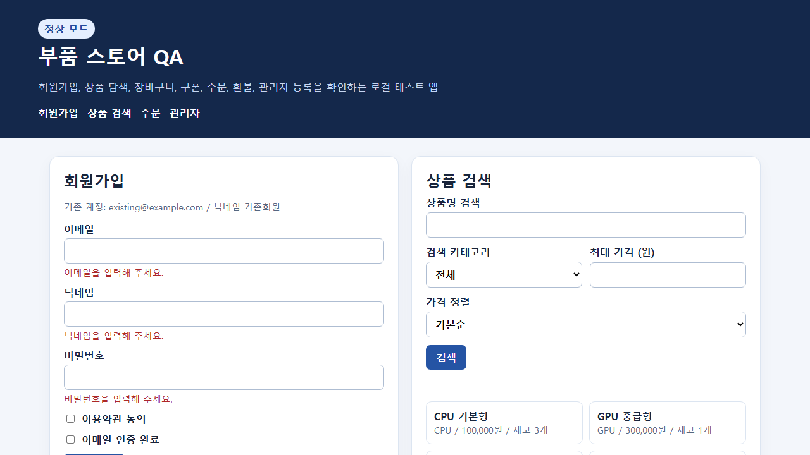
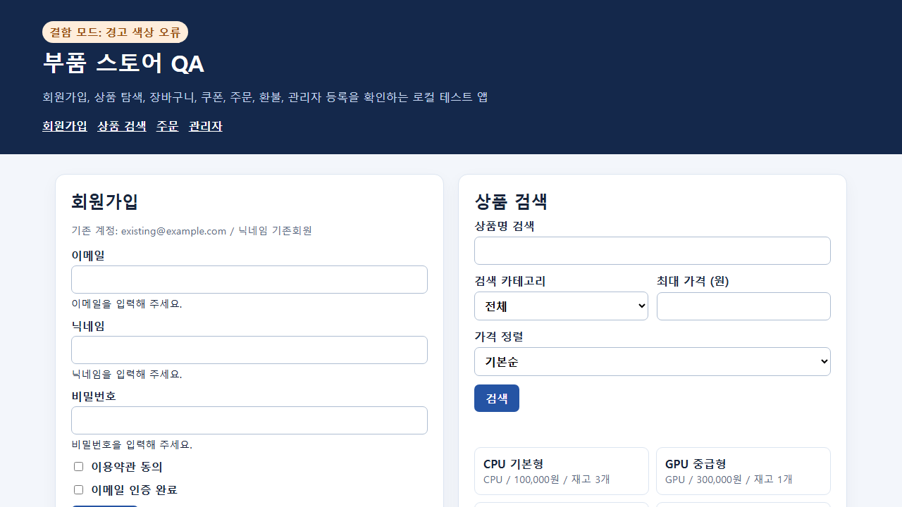
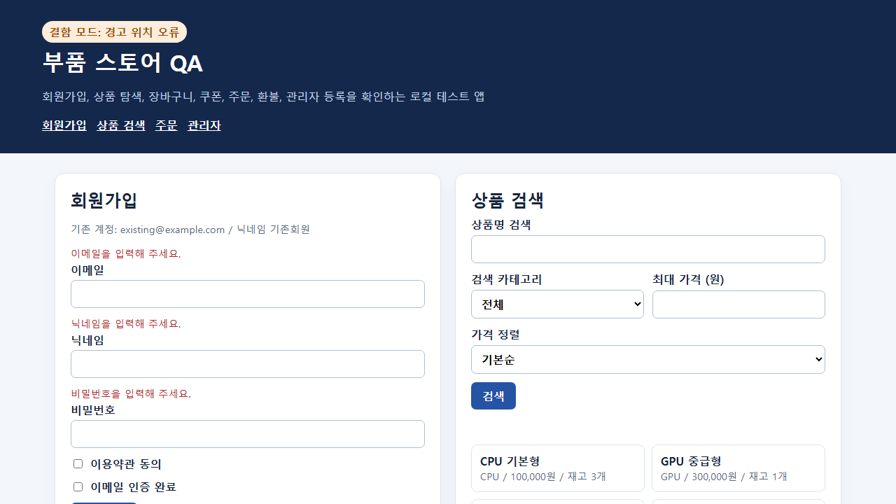

# 4단계: 실제 Playwright 실행과 성공/실패 캡처

작업 위치: `D:\common_tester`. 실행 ID: `70f5e9aa1507422c87a34e8b3f2ca2b9`.

## 원문 하나를 따라가는 실행 예

1. **제품 원문**: `BE_USER_001`, PDF 1쪽 표 5행에 “회원가입 버튼 클릭시 미입력 정보가 있으면 입력칸 하단에 빨간색 경고 메세지 제공”이라고 적혀 있다.
2. **임베딩 입력 보완**: 이 문구가 포함된 356자 문단은 실제 178토큰이었다. 128토큰으로 잘리던 문자 수 분할을 토큰 기준으로 고쳤다. 현재 문단 4의 조각 1은 127토큰, 조각 2는 53토큰이다. 두 조각을 이어 붙이면 원문과 완전히 같다. 전체는 88조각에서 117조각으로 바뀌었다.
3. **근거**: `retrieve_evidence`가 문단 4의 조각 1과 2를 원문과 함께 반환한다. 이번 범위는 `전체`여서 75행을 모두 가져온다. 모든 상황은 원문 문단의 전체 조각을 출처로 보존한다.
4. **API 명세**: “가입 버튼을 누른다 → 입력칸 하단에 빨간 경고가 제공된다”가 `expected_policy=deny`, `scenario_key=BE_USER_001@pdf:1:5-DENY-4`로 구조화된다. 새 전체 명세는 190상황(허용 163, 거부 27), 미확정 사유 113건이다.
5. **생성 코드**: Codex App Server가 명세와 예제 HTML을 읽고 상황별 테스트를 만든다. 이 예시는 필수 입력 3개 각각의 경고 표시, 비어 있지 않은 내용, 실제 계산 색상, 실제 경고/입력칸 좌표를 검사한다.
6. **정상 앱 실행**: 경고는 `rgb(173, 40, 40)`이고 각 입력칸 아래에 표시되므로 이 테스트가 통과한다. 예상된 거부가 올바르게 나온 테스트 통과다.
7. **색상 결함 실행**: 같은 코드를 `?bug=warning-color`에 실행하면 경고가 `#18243b`로 바뀌어 색상 assertion이 실패한다.
8. **위치 결함 실행**: 같은 코드를 `?bug=warning-position`에 실행하면 경고가 입력칸 위로 옮겨져 좌표 assertion이 실패한다.
9. **증거**: 위 세 실행 모두 스크린샷이 남고, 실패한 실행에는 오류와 trace가 남는다. 테스트 코드는 결함 모드에 따라 기대값을 바꾸지 않는다.

원문 → 원문 조각 → 근거 JSON → 명세 JSON → TypeScript → 실행 결과 → PNG가 같은 scenario key로 이어진다.

## 실제 생성된 판정 코드

```ts
for (const field of ['email', 'nickname', 'password']) {
  const input = page.locator(`#member-${field}`);
  const warning = page.locator(`#member-${field}-error`);
  await expect(warning).toBeVisible();
  await expect(warning).not.toBeEmpty();
  const color = await warning.evaluate(element => getComputedStyle(element).color);
  const channels = color.match(/\d+/g)?.map(Number);
  expect(channels![0]).toBeGreaterThan(channels![1]);
  expect(channels![0]).toBeGreaterThan(channels![2]);
  const inputBox = await input.boundingBox();
  const warningBox = await warning.boundingBox();
  expect(warningBox!.y).toBeGreaterThanOrEqual(inputBox!.y + inputBox!.height);
}
```

색상 검사는 원문에 없는 정확한 색상값을 요구하지 않고 빨간 채널 우세로 구현했다. 이는 붉은 계열의 근사 판정이며 모든 색상 인지 기준을 보장하는 것은 아니다.

## 최종 실행 결과

동일한 20개 테스트를 5번 실행했다. 총 100건 중 통과 96건, 의도한 결함 검출 4건이다. 테스트 코드 사본과 SHA-256이 다섯 실행에서 동일하다.

| 모드 | 통과 | 실패 | PNG | 실행 ID |
| --- | ---: | ---: | ---: | --- |
| normal | 20 | 0 | 20 | `12e81989896249a49ef65073acd7dba6` |
| email | 19 | 1 | 20 | `b986631ecadb474e8b14445b24f364bd` |
| blank-accepted | 19 | 1 | 20 | `2d5fb5e3fcb14ec1ac367ee0436ecfd1` |
| warning-color | 19 | 1 | 20 | `e700fa2fb0f24299984319fec9fb99be` |
| warning-position | 19 | 1 | 20 | `036efceeb29e4e5d9d8b3b47a5939495` |

- `email`: 유효한 이메일을 거부하는 결함을 정상 가입 테스트가 검출했다.
- `blank-accepted`: 빈 가입을 허용하는 결함을 빈 입력 경고 테스트가 검출했다.
- `warning-color`: 경고 색상만 잘못된 경우를 검출했다.
- `warning-position`: 경고 위치만 잘못된 경우를 검출했다.
- 최종 100건 모두 PNG가 존재하며 파일 헤더도 확인했다. 캡처 오류는 0건이고 실패 4건에는 trace가 있다.

## 정상과 실패 화면

정상 앱에서 기대된 거부가 나와 테스트 통과:



색상 결함이 있어 테스트 실패:



위치 결함이 있어 테스트 실패:



## 구현과 저장 위치

- 실제 그래프: `retrieve_evidence → build_handoff → generate_playwright → run_playwright`.
- API 명세 생성에는 `.env`의 API 키를 사용한다. Codex와 Playwright 자식 프로세스에는 API 키를 전달하지 않는다.
- 정상/결함은 하나의 `examples/product-demo.html`을 사용하고 URL의 결함 상태만 바꾼다. Docker를 사용하지 않는다.
- `api/playwright_runner.py`가 Node.js Playwright Test를 실행한다. 테스트 실패(exit code 1)는 점검 결과로 보존하고, 앱 접속/런처 문제는 `execution_error`로 구분한다.
- Playwright 설정은 `screenshot: 'on'`, `trace: 'retain-on-failure'`, 재시도 0회다.
- 각 실행은 `.local/runs/<run_id>/executions/<execution_id>/`에 `execution.json`, `failures.json`, `playwright-results.json`, `playwright.log`, `test-source/`, `test-results/`를 갖는다.
- `failures.json`에는 실패 사례만 있다. `execution.json`에는 기대 정책, 기대 관찰, 출처, 상태, 오류, 이미지, trace 및 미실행 이유가 있다.
- 동일 run의 재실행도 별도 execution ID를 만들어 이전 파일과 섞이지 않는다.

## 최초 실행에서 바로잡은 것

최초에는 21건 중 2건이 생성 테스트 문제로 실패했다. 원문에 없는 “가입”이라는 오류 문구를 요구한 경우와, 주문을 만들지 않고 환불을 시도한 경우다. 이 실행 자료와 코드는 `revisions/initial-generation/` 및 최초 execution 폴더에 보존했다.

- 약관 미동의 테스트는 인증 상태를 유효하게 두고 실제 거부 신호를 확인하도록 수정했다.
- 환불 테스트는 쿠폰을 사용한 유효 주문을 먼저 만들고, 같은 상품의 재고 `3 → 2 → 3`과 쿠폰 재사용을 확인한다. 예제 앱도 원문대로 재고와 사용 쿠폰을 복원하도록 보완했다.
- 필수 항목 누락 테스트가 완성된 양식의 성공을 검사하던 오류를 바로잡았다. 예제 앱 등록 버튼도 필수 값 누락 시 비활성화한다.
- 분류별 필수 사양을 입력할 UI가 없는 전체 제품 등록 상황은 통과로 계산하지 않고 미지원으로 바꿨다.
- Codex 생성 지침에도 같은 사전 조건과 원문 충실성 검토 기준을 반영했다. 생성 코드가 항상 정확하다는 보장은 없으며 이번 결과에는 검토/수정 기록이 있다.

## 로컬 예제 실행

프로젝트 루트에서 별도 터미널에 다음 명령을 실행하면 예제 주소를 제공한다.

```powershell
.\.venv\Scripts\python.exe -m http.server 8765 --bind 127.0.0.1 --directory examples
```

API 전체 실행 입력은 다음과 같다. 기존 원문이 수정됐다면 먼저 해당 버전을 다시 임베딩한다.

```json
{"product":"product","version":"v1","target_url":"http://127.0.0.1:8765/product-demo.html","scope":"전체"}
```

이번 명세 API 모델은 `gpt-5.4-mini`이고, App Server가 응답한 실제 코드 생성 모델은 `gpt-6-luna`다. `test-spec.json`과 `generation.json`에 각각 기록한다.

## API 사용

- `POST /api/runs`: 제품/버전/대상 URL/범위를 받아 네 단계를 실행한다. 현재 동기 요청이다.
- `POST /api/runs/<run_id>/generate-playwright`: 이미 만든 명세에서 생성 노드만 실행한다.
- `POST /api/runs/<run_id>/execute`: 이미 생성한 테스트를 실행한다. `{"target_url":"http://127.0.0.1:8765/product-demo.html?bug=warning-color"}`로 대상을 바꿀 수 있다.
- `GET /api/runs/<run_id>/executions/<execution_id>`: 정리된 결과를 읽는다.
- `GET /api/runs/<run_id>/executions/<execution_id>/files/<상대경로>`: 해당 실행 안의 이미지와 결과 파일을 읽는다. 실행 폴더 밖은 거부한다.

## 검증과 범위

`api/check_foundation.py`의 버전 격리 확인과 `api/check_stage4.py`의 원문 보존, 토큰 한도, 네 그래프 노드, 190상황의 생성/미지원 목록, 네 결함 검출, 모든 PNG, trace, 결과 API, 폴더 이탈 거부, 런처 오류 분리가 통과했다.

생성된 테스트는 20개이고 나머지 170상황은 해당 예제에서 필요한 화면이나 사전 조건을 만들 수 없어 미지원 이유를 기록했다. 190개 전체를 실행했다고 계산하지 않는다. 이메일 인증 체크박스와 권한 선택은 테스트용 상태이며 실제 이메일/로그인 통합 검증이 아니다. 종합 TP/FN/FP/TN 분류와 React 실행 결과 화면은 다음 5단계다.


후속 변경: 5단계에서 결과 집계 노드와 React 화면을 연결하고 전체 실행 API를 백그라운드 처리로 변경했다. 현재 동작은 [5단계 기록](05-results-workspace.md)을 참조한다.
