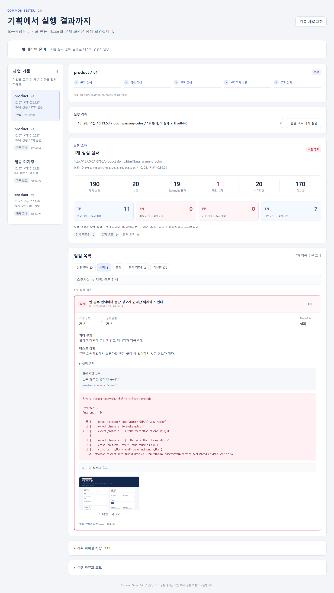
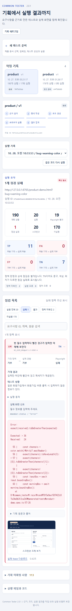

# 5단계: 결과 집계와 React 작업 화면

작업 위치: `D:\common_tester`.

## 이번 단계에서 연결한 것

| 구분 | 구현 |
| --- | --- |
| 그래프 | 기존 네 노드 뒤에 `summarize_results` 연결 |
| 정책 판정 | 기대 정책과 실제 화면의 허용/거부 신호를 비교해 TP, FN, FP, TN 분류 |
| 상세 판정 | Playwright assertion, 실행 오류, 캡처 오류를 별도로 기록 |
| React | 작업 기록, 실행 선택, 실패 우선 목록, 필터, 검색, 원문 출처, 이미지 확대 |
| 추적 | 작업 ID, 실행 ID, 테스트 코드 사본, 관찰 계약, 파일 해시, PNG, trace 연결 |
| 진행 상태 | 전체 실행 요청은 202 응답 후 백그라운드 처리, 화면에서 3초마다 진행 조회 |

처리 순서는 `retrieve_evidence → build_handoff → generate_playwright → run_playwright → summarize_results`다. 결과 집계에서 LLM을 다시 호출하지 않는다.

## 원문 하나가 결과로 바뀌는 과정

이번 예시는 `BE_USER_001`, 원본 PDF 1쪽 표 5행의 아래 문구다.

> 회원가입 버튼 클릭시 미입력 정보가 있으면 입력칸 하단에 빨간색 경고 메세지 제공

| 순서 | 실제 처리 | 값 또는 파일 |
| --- | --- | --- |
| 1. 원문 보관 | 요구사항 ID와 PDF 위치를 유지한 회원가입 문단을 저장 | `documents/product/v1/requirements.md`, 문단 4 |
| 2. 임베딩 | 문단 전체 178토큰을 127토큰과 53토큰으로 나눈다. 각 조각을 384차원 벡터로 저장한다. 각 조각의 특수 토큰도 토큰 수에 포함된다. | 같은 버전의 `embeddings.sqlite3`, 문단 4 / 조각 1, 2 |
| 3. 근거 조회 | 저장된 원문 조각과 출처를 함께 가져온다. 벡터에서 원문을 복원하는 과정은 없다. 전체 범위에서는 75개 요구사항 행을 빠짐없이 읽는다. | `evidence.json` |
| 4. API 명세 | 원문을 근거로 상황, 행동, 기대 관찰, 허용/거부를 구조화한다. API에는 벡터 숫자가 아닌 조회된 원문과 출처가 전달된다. | `test-spec.json` |
| 5. 코드 생성 | 명세와 예제 HTML을 Codex App Server에 전달한다. 빈 가입의 필수 입력 3개 각각에 대해 경고 내용, 실제 계산 색상, 입력칸과 경고의 위치를 검사한다. | `generated-tests/product-demo.spec.ts` |
| 6. 실제 정책 관찰 | 테스트 종료 시 실제 결과 요소의 상태를 읽는다. assertion의 성공/실패로 실제 정책을 추측하지 않는다. | `observations.json` + `playwright-observations.ts` |
| 7. 실행 기록 | 성공과 실패 모두 PNG를 남긴다. assertion 오류와 관찰 JSON을 같은 scenario key에 연결한다. | 실행별 `execution.json`, `playwright-results.json`, PNG, trace |
| 8. 집계 | 기대 거부와 실제 거부를 비교하면 TN이다. 색상 assertion이 틀리면 TN을 유지하면서 상세 점검 실패로 기록한다. | 실행별 `report.json` |
| 9. 화면 | 실패를 먼저 보여주고 기대 결과, 실제 신호, 오류, 원문과 출처, 이미지를 함께 표시한다. | React 결과 화면 |

2단계 임베딩은 다국어 MiniLM Transformer가 문맥을 계산한 뒤 토큰 표현을 평균해 문장 벡터를 만드는 방식이다. 모델과 분할 방식의 자세한 보완 내용은 [4단계 기록](04-playwright-execution.md)에 있다. 임베딩은 원문을 대신하는 압축 문서가 아니다.

### 명세 JSON

이 문구에서 실제 생성된 항목을 필요한 필드만 표시했다.

```json
{
  "scenario_key": "BE_USER_001@pdf:1:5-DENY-4",
  "expected_policy": "deny",
  "situation": "일반 회원가입에서 회원가입 버튼 클릭 시 입력하지 않은 정보가 있다.",
  "expected_observation": "입력칸 하단에 빨간색 경고 메세지가 제공된다.",
  "source_refs": [
    {"path": "requirements.md", "paragraph_no": 4, "chunk_no": 1},
    {"path": "requirements.md", "paragraph_no": 4, "chunk_no": 2}
  ]
}
```

### Codex에 추가한 관찰 계약

테스트 코드와 함께 다음 형태의 `observations.json`을 만들도록 생성 지침과 검증을 추가했다. 코드의 상세 assertion과 구분해 실제 동작의 허용/거부를 관찰하기 위한 파일이다.

```json
{
  "scenario_key": "BE_USER_001@pdf:1:5-DENY-4",
  "kind": "class",
  "selector": "#member-status",
  "allow_class": "success",
  "deny_class": "error",
  "reason": "회원가입 처리 결과"
}
```

| 계약 종류 | 실제 관찰 |
| --- | --- |
| class | 결과 요소에 허용 클래스만 있으면 allow, 거부 클래스만 있으면 deny |
| disabled | 동작 버튼이 비활성화됐으면 deny, 활성화됐으면 allow. 실제 제출 성공까지 보장하는 신호는 아니다. |
| unknown | 화면에서 정책 허용/거부를 구분할 근거가 없으면 unknown |

관찰 요소가 없거나 상태가 중복되거나 읽기에 실패해도 unknown이다. `expected_policy`, URL의 결함 이름, assertion 결과로 `actual_policy`를 채우지 않는다. 현재 예제의 20개 테스트 중 18개에 명시적 관찰 신호가 있고 조회 전용 2개에는 없다.

각 spec은 `../../../../playwright-observations`의 test fixture를 가져온다. fixture는 테스트 성공 여부와 관계없이 종료 시점에 관찰 JSON을 Playwright attachment로 남긴다. Python 실행기는 attachment를 읽어 `execution.json`에 보존한다. 집계 노드는 그 결과만 사용한다.

### 정상 앱과 색상 결함 앱의 차이

| 값 | 정상 앱 | 색상 결함 앱 |
| --- | --- | --- |
| 기대 정책 | deny | deny |
| 실제 결과 요소 | `#member-status`, `class=error` | `#member-status`, `class=error` |
| 실제 문구 | 필수 정보를 입력해 주세요. | 필수 정보를 입력해 주세요. |
| actual_policy | deny | deny |
| classification | TN | TN |
| 경고 색상 | `rgb(173, 40, 40)` | `rgb(24, 36, 59)` |
| 색상 assertion | 빨강 채널이 다른 두 채널보다 커서 통과 | 빨강 24가 초록 36보다 크지 않아 실패 |
| verdict | passed | failed |
| 스크린샷 | 있음 | 있음 |

상세 오류에는 `Expected: > 36 / Received: 24`가 남는다. 따라서 실패 목록에서 이 항목은 **실패 / TN**으로 표시한다. 빈 입력이 허용되는 결함은 실제 `success` 상태가 관찰되므로 **실패 / FP**다. 정상 입력을 거부하는 결함은 **실패 / FN**이다.

## 분류 기준

| 기대 정책 | 실제 관찰 | 사분면 | 의미 |
| --- | --- | --- | --- |
| allow | allow | TP | 허용해야 할 상황을 허용 |
| allow | deny | FN | 허용해야 할 상황을 잘못 거부 |
| deny | allow | FP | 거부해야 할 상황을 잘못 허용 |
| deny | deny | TN | 거부해야 할 상황을 거부 |
| 둘 중 하나 | unknown | 분류 없음 | 관찰 근거 부족 |
| 둘 중 하나 | 실행 환경 오류 | 분류 없음 | 브라우저 시작, 접속 등 실행 오류 |

- 상세 판정 순서는 실행 오류, assertion/정책 불일치/캡처 실패, 정책 미확인, 통과다.
- FN과 FP는 실패다. TP와 TN도 색상이나 위치 assertion이 틀리면 상세 실패가 될 수 있다.
- 정책 관찰이 없는 과거 실행은 통과 여부로 사분면을 역산하지 않는다.
- 미실행은 TP, FN, FP, TN에 넣지 않는다. 미확정 기획과 미지원 사유도 구분한다.
- Playwright 통과 수와 정책 미확인 수는 서로 배타적인 숫자가 아니다. 조회 화면 assertion을 통과했지만 허용/거부 신호가 없는 2개가 실제 예다.

## 5단계 실제 실행 결과

기존 190상황 명세와 검토된 20개 테스트를 사용했다. 관찰 계약과 fixture를 연결한 뒤 동일한 코드를 정상 앱과 네 결함 앱에 실행했다.

| 앱 상태 | 실행 | Playwright 통과 | 상세 실패 | TP | FN | FP | TN | 정책 미확인 | PNG |
| --- | ---: | ---: | ---: | ---: | ---: | ---: | ---: | ---: | ---: |
| 정상 | 20 | 20 | 0 | 11 | 0 | 0 | 7 | 2 | 20 |
| 정상 가입 거부 | 20 | 19 | 1 | 10 | 1 | 0 | 7 | 2 | 20 |
| 빈 가입 허용 | 20 | 19 | 1 | 11 | 0 | 1 | 6 | 2 | 20 |
| 경고 색상 오류 | 20 | 19 | 1 | 11 | 0 | 0 | 7 | 2 | 20 |
| 경고 위치 오류 | 20 | 19 | 1 | 11 | 0 | 0 | 7 | 2 | 20 |

합계는 브라우저 점검 100건, PNG 100장, 상세 실패 4건, 실패 trace 4개다. 각각의 실행에서 미실행 170개는 동일하며 계획 190개 전체를 실행한 것으로 계산하지 않는다.

| 앱 상태 | execution ID |
| --- | --- |
| 정상 | `53f451a868ed40e6a8f4cb7a522248c8` |
| 정상 가입 거부 | `876da599be3840ca97f903603c7b0e5d` |
| 빈 가입 허용 | `5a3f3f220118493ea9c55ac40c602090` |
| 경고 색상 오류 | `1f5e8445ee4c40608967076e78c6898c` |
| 경고 위치 오류 | `4822754055fe4dc98fb3a15c01c2b4f9` |

공통 run ID는 `70f5e9aa1507422c87a34e8b3f2ca2b9`다. `.local/stage5-latest.json`에도 정리했다.

## 관찰 계약 생성 연결 확인

기존 테스트에 계약을 연결하는 확인 외에, 실제 Codex App Server가 새 spec과 observations.json을 직접 만드는 경로도 실행했다.

- 입력: 같은 회원가입 원문에서 허용 상황과 빈 입력 거부 상황 2개를 전달했다.
- 실제 모델: `gpt-6-luna`.
- 생성: 빈 입력 거부 테스트 1개, 관찰 계약 1개. 허용 상황은 실제 이메일 인증 화면이 없어 미지원으로 기록했다.
- 정상 앱: 1개 통과, 실제 거부를 관찰해 TN, PNG 1장.
- 색상 결함 앱: 같은 코드 1개 실패, 실제 거부는 유지돼 TN, PNG 1장과 trace.
- 자료: `.local/checks/stage5-generation/9b09ae17ecec4468ad165e1893e80e0e/`. 요약은 `.local/stage5-generation-smoke.json`.

이 추가 2회 점검은 위 100건 비교와 별도다. 기존 20개 중 정상 가입 테스트는 데모 인증 체크박스 상태에서의 화면 처리 확인이며 실제 이메일 발송/인증 검증으로 해석하면 안 된다. 새 생성에서는 이 전제 부족을 미지원으로 판단했다. 생성 가능한 수는 명세와 화면의 사전 조건 충족 여부에 따라 달라진다.

## React 화면에서 확인하는 방법

1. `http://127.0.0.1:5173/`를 연다.
2. 왼쪽에서 product / v1의 190상황 작업을 고른다.
3. 실행 기록에서 원하는 정상/결함 실행을 고른다.
4. 실패가 있으면 실패 필터가 기본 선택된다.
5. 실패 항목에서 기대 정책과 실제 신호, assertion 오류를 확인한다.
6. 기획 원문과 출처를 펼쳐 요구사항 문장과 문단/조각을 확인한다.
7. 스크린샷을 누르면 원본 크기로 확대된다. Escape 또는 닫기로 닫는다.
8. 미실행 170을 누르면 실행하지 못한 이유와 해당 원문을 확인한다.
9. 실행 파일과 코드에서 해당 실행의 사본과 해시, JSON, log, trace를 받을 수 있다.

TP, FN, FP, TN 카드를 누르면 해당 분류만 보여준다. 검색은 요구사항 ID, 제목, 원문에 적용된다. URL에 작업/실행 ID를 유지하므로 같은 결과 화면을 다시 열 수 있다.





## 파일과 API

| 파일 | 역할 |
| --- | --- |
| `api/results.py` | 관찰 기반 분류, 실패 우선 정렬, 근거/이미지 연결, report.json 저장 |
| `api/workflow.py` | 집계 노드 연결, 노드별 진행 상태, 백그라운드 작업 실행/오류 보관 |
| `api/main.py` | 작업 기록과 실행별 보고서 API |
| `api/codex_generator.py` | 관찰 계약 생성 지침과 생성 산출물 검증 |
| `playwright-observations.ts` | 테스트 종료 후 실제 화면 신호 attachment |
| `api/playwright_runner.py` | 관찰 attachment 읽기, 계약과 fixture의 실행 시점 사본 보관 |
| `web/src/App.tsx`, `style.css` | 신규 React 결과 작업 화면 |
| `api/check_stage5.py` | 사분면, 상세 실패, 과거 기록, API, 실행 오류 확인 |

| API | 동작 |
| --- | --- |
| `POST /api/runs` | 제품/버전/대상/범위 검증 후 202와 run ID 응답. 백그라운드에서 다섯 노드 실행 |
| `GET /api/runs` | 작업 목록과 각각의 실행 요약 |
| `GET /api/runs/{run_id}` | 현재 노드, 상태, 오류, 실행 기록 |
| `POST /api/runs/{run_id}/execute` | 기존 코드를 새 execution ID로 실행하고 집계 |
| `GET /api/runs/{run_id}/executions/{execution_id}/report` | 기대/관찰/판정/원문/이미지를 연결한 보고서 |
| `GET /api/runs/{run_id}/executions/{execution_id}` | 실행 원본 JSON |
| `GET /api/runs/{run_id}/executions/{execution_id}/files/{path}` | 해당 실행 폴더 안 파일만 제공 |

결과는 `.local/runs/{run_id}/executions/{execution_id}/report.json`에 저장한다. 작업 폴더의 report.json은 가장 최근 실행의 요약본이며 과거 보고서를 조회한다고 최신 실행을 바꾸지 않는다. 서버 재시작 시 대기/진행 중이던 작업은 중단 오류로 표시해 진행 표시가 영구히 남지 않게 한다.

## 검증 범위와 남은 단계

- `api/check_stage5.py`: 실제 다섯 실행의 100개 PNG, 네 사분면, TN의 색상/위치 실패, 과거 실행의 미확인 처리, 백그라운드 API와 작업 오류, 결과 파일 접근 검증 통과.
- `web`의 TypeScript 검사와 Vite 빌드 통과.
- `node web/check_stage5_ui.cjs`: 실제 React 화면의 실행 전환, 실패 필터, 미실행 170개, 검색, 원문, 이미지 확대/닫기, 390px 모바일 표시 확인. 브라우저 오류와 실패한 HTTP 요청 없음.
- 현재 정책 관찰은 class, disabled 신호를 지원한다. 앱이 다른 방식의 처리 신호를 사용하면 그 신호를 읽는 계약을 추가해야 한다. 근거가 없으면 미확인으로 남긴다.
- 예제에서 지원하지 않는 170상황은 여전히 미실행이다. 이메일 인증 체크박스와 관리자 역할 선택은 데모 상태다.
- 6단계는 새 작업 ID 두 개로 근거 검색부터 생성, 실행, 집계까지 처음부터 반복하고 파일이 섞이지 않는지 확인하는 작업이다.


후속 확인: [6단계 전체 재실행 기록](06-full-reexecution.md)에 새 명세 두 건의 실제 생성/실행 결과, 발견한 오류, 검토 수정과 파일 격리 확인을 기록했다.
