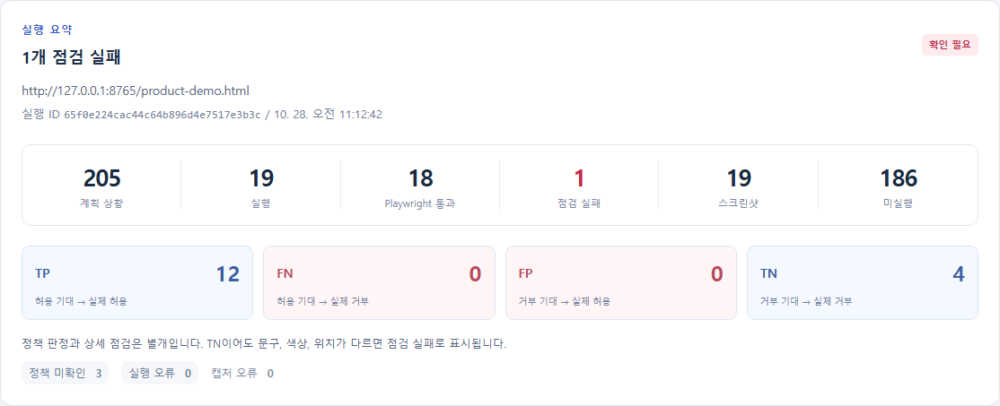
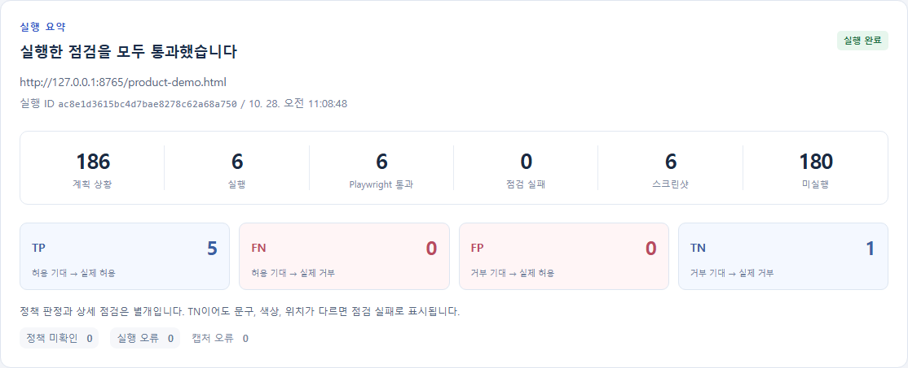
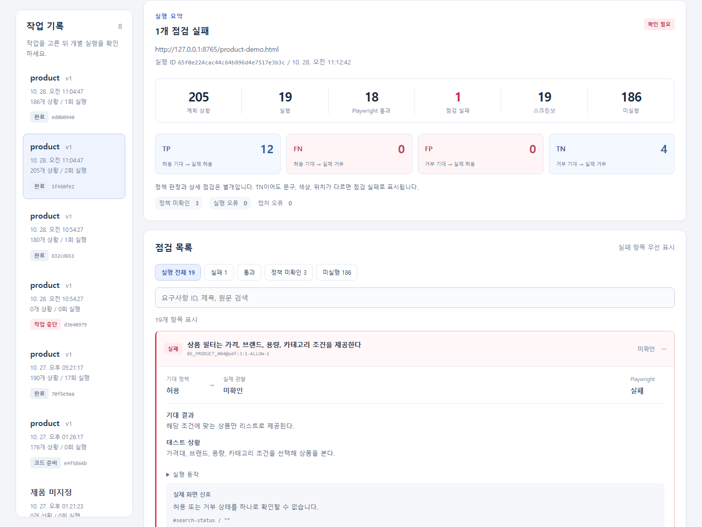
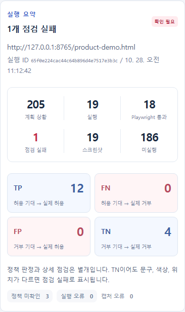

# 6단계: 전체 반복 실행과 작업별 파일 격리

작업 위치: `D:\common_tester`.

## 확인 기준

| 대상 | 확인 방법 |
| --- | --- |
| 새 전체 실행 | API의 `POST /api/runs`로 새 작업 ID 두 개를 만들고 다섯 노드가 끝날 때까지 조회 |
| 근거 범위 | 같은 product/v1 임베딩에서 75개 요구사항 행을 모두 조회했는지 대조 |
| 중복 ID | BE_RECOMMEND_001 두 행을 원본 PDF 위치별로 유지했는지 확인 |
| 실제 모델 호출 | 새 OpenAI response ID와 새 Codex thread ID인지 확인 |
| 명세 출처 | 원문, 문단과 조각이 해당 요구사항의 저장된 근거와 같은지 확인 |
| 생성 범위 | 모든 명세 상황이 생성 또는 미지원으로 한 번씩 기록됐는지 확인 |
| 실행 범위 | 생성된 상황 목록과 Playwright 실행 결과가 일치하는지 확인 |
| 실행 시점 코드 | 테스트 코드, 관찰 계약, fixture 사본의 SHA-256을 원본과 비교 |
| 이미지 | 실행한 항목마다 PNG가 있고 파일 헤더와 경로가 올바른지 확인 |
| 결과 접근 | 다른 작업 ID와 실행 ID를 조합한 조회는 404인지 확인 |
| 이전 자료 | 실행 전 저장한 기존 결과와 제품 원문 파일의 해시를 실행 후 대조 |

순서는 `retrieve_evidence → build_handoff → generate_playwright → run_playwright → summarize_results`다. 이전 단계의 test-spec.json이나 생성 코드를 새 작업에 복사하지 않는다. 임베딩은 이미 저장되어 있으므로 다시 만들지 않는다.

## 최초 반복 실행에서 발견한 문제

| 작업 | ID | 결과 |
| --- | --- | --- |
| 최초 A | `d3e409798ff54c3aa3b3861483ee7932` | 모델이 잘못된 원문 출처를 반환해 build_handoff의 검증에서 중단 |
| 최초 B | `832cd651fc05448682cb424f9ce45e87` | 75개 요구사항과 180개 상황에서 14개 테스트 실행. 통과 9개, 선택자 시간 초과 4개, 표시 누락 1개 |

기존 코드는 12개 요구사항씩 API를 일곱 번 호출한 뒤 전체 명세의 출처를 검사했다. 첫 묶음이 잘못돼도 나머지 호출이 끝나야 오류를 알 수 있었다. 잘못된 명세를 Codex로 넘기지는 않았지만 불필요한 호출이 발생했고 재요청이 없었다.

### 수정

1. API 응답을 묶음마다 즉시 검사한다.
2. 해당 묶음의 요구사항 키가 빠지거나 추가되지 않았는지 확인한다.
3. 각 상황의 path, paragraph_no, chunk_no가 그 요구사항의 실제 출처인지 확인한다.
4. 상황, 행동, 기대 관찰이 비어 있으면 거부한다.
5. 실패한 응답과 오류를 `revisions/spec-validation/batch-N-attempt-N.json`에 보관한다.
6. 첫 오류는 구체적인 검증 피드백과 함께 같은 묶음만 한 번 재요청한다.
7. 두 번째도 틀리면 그 작업을 중단한다. 출처를 임의로 고쳐 통과시키지 않는다.

`api/check_spec_validation.py`에서 잘못된 문단 번호 거부, 한 번의 재요청, 두 번 실패 시 중단, 실패 응답 보관과 사용량 누적을 확인했다.

## 최초 B의 실패 원인과 수정

| 원인 | 실제 증거 | 수정 |
| --- | --- | --- |
| 선택 상자의 라벨 | `getByLabel('검색 카테고리', {exact:true})`, `getByLabel('현재 권한', {exact:true})`가 요소를 찾지 못해 30초 시간 초과 | select를 감싼 label에는 option 텍스트도 포함될 수 있으므로, 생성 지침에 실제 HTML의 select ID를 쓰도록 명시 |
| 시간 초과 분류 | 관리자 버튼은 초기 상태부터 비활성화되어 있어 테스트가 중간에 멈췄어도 TN으로 보일 수 있었음 | 테스트 전체 시간 초과와 모호한 선택자 오류를 실행 오류로 분리. 이런 경우 사분면을 계산하지 않음 |
| 환불 요약 표시 | BE_PRODUCT_018 원문에는 상품명, 옵션, 수량, 쿠폰, 금액이 있는데 예제의 주문 요약에는 상태와 결제 금액만 있었음 | 이미 저장된 주문 품목에서 상품명, 수량, 품목 금액, 적용 쿠폰을 표시. 예제에 없는 상품 옵션을 임의로 만들지 않음 |

기획상 필수 표시의 누락은 실제 화면 실패이며 테스트의 기대값을 삭제해 통과시키지 않았다. 반대로 선택자 시간 초과는 제품이 정책을 잘못 허용/거부했다고 단정할 근거가 없어 실행 오류로 분리했다. assertion이 정상적으로 실행된 색상 실패 등은 여전히 상세 점검 실패로 남는다.

최초 B의 원본 보고서는 `revisions/initial-stage6-report.json`에 보관했다. 관찰된 실제 정책은 유지하되 시간 초과의 사분면을 제거한 보고서를 다시 집계했다. 최초 반복 자료는 `.local/stage6-attempts/initial.json`에 보관했다.

최초 기준 488개 파일 중 의도적으로 수정한 `examples/product-demo.html`만 달라졌으며 이전 실행 자료를 포함한 나머지 487개는 같은 해시였다. 최종 반복 검증은 이 수정 이후의 파일들을 다시 기준으로 잡았다.

## 원문에서 최종 확인까지 이어지는 예

1. **원문**: BE_PRODUCT_018은 환불 요청 시 주문한 상품 전체의 이름과 수량, 금액 등을 보여주도록 정한다.
2. **저장 근거**: product/v1의 원문 조각과 문단/조각 번호를 그대로 조회한다. 원본 ID와 PDF 위치를 유지한다.
3. **API 명세**: 주문한 상품 정보와 합계를 확인하는 상황이 expected_policy=allow로 만들어진다.
4. **Codex 코드**: 결제 주문을 먼저 만들고 환불을 요청한 뒤 주문 요약에서 상품명과 수량을 확인하는 assertion을 만든다.
5. **최초 실행**: 환불 요청 자체는 허용됐지만 상품명이 표시되지 않아 assertion이 실패했다. 정책 TP와 상세 점검 실패가 함께 기록됐다.
6. **예제 수정**: 실제 주문 items의 상품명과 수량, 금액을 주문 요약에 표시했다. 테스트의 기대값은 그대로 유지했다.
7. **재검증**: 수정 후 새 작업 ID로 원문 조회, 명세 작성, 코드 생성부터 다시 실행한다. 기존에 만든 테스트만 다시 돌린 결과와 구분한다.

## 직접 다시 확인하는 명령

로컬 API, React, 예제 앱이 실행 중인 프로젝트 루트에서:

```powershell
# 기존 최종 자료 검증. 모델을 새로 호출하지 않는다.
.\.venv\Scripts\python.exe api\check_stage6.py

# 새 전체 작업 두 개를 시작한 뒤 검증. 실제 OpenAI API와 Codex를 호출한다.
.\.venv\Scripts\python.exe api\check_stage6.py --run
```

입력은 product / v1, 범위 전체, 대상 `http://127.0.0.1:8765/product-demo.html`이다. 두 작업을 함께 시작해 실행 폴더 격리도 확인한다. OpenAI 명세의 상황 수는 생성마다 달라질 수 있다. 고정 개수와 비교하는 대신 원문의 75개 요구사항 목록, 출처, 각 명세의 생성/미지원 및 실행 목록을 대조한다.

진행 자료는 `.local/stage6-latest.json`, 검증 결과는 `.local/stage6-check.json`에 저장한다. 검증 스크립트는 API 키를 읽거나 출력하지 않으며 실제 호출은 기존 API 서버가 처리한다.


## 최종 전체 실행 결과

두 작업 모두 새 evidence.json과 test-spec.json을 생성하고 별도 Codex 대화에서 테스트를 만들었다. 명세 API는 gpt-5.4-mini, 코드 생성은 App Server가 응답한 gpt-6-luna를 사용했다.

| 항목 | A | B |
| --- | ---: | ---: |
| 원문 요구사항 행 | 75 | 75 |
| 명세 상황 | 205 | 186 |
| 실제 명세 API 호출 | 7 | 8 |
| 잘못된 출처 재요청 | 0 | 1 |
| 생성된 테스트 | 19 | 6 |
| 최종 실행 | 19 | 6 |
| Playwright 통과 | 18 | 6 |
| 실제 화면 누락으로 실패 | 1 | 0 |
| 실행 오류 | 0 | 0 |
| 정책 미확인 | 3 | 0 |
| 미실행 | 186 | 180 |
| PNG | 19 | 6 |
| TP / FN / FP / TN | 12 / 0 / 0 / 4 | 5 / 0 / 0 / 1 |

A의 실패 1개는 BE_PRODUCT_004의 브랜드 필터가 화면에 없는 경우다. 해당 요구사항은 가격대, 브랜드, 용량, 카테고리 조건을 제공하도록 정한다. 생성된 코드가 브랜드 필터를 찾는 assertion에서 실패했고 실제 허용/거부 신호는 없으므로 **상세 실패 / 정책 미확인**이다. 이를 FN이라고 추측하지 않았다. 이 정책 미확인 1개와 조회용 미확인 2개가 합쳐져 A의 정책 미확인은 3개다.

### A의 생성 코드 검토 1건

A의 최초 전체 실행은 19개 중 17개 통과, 실제 필터 누락 1개, 생성 코드 실행 오류 1개였다. 생성 코드가 상품명 미입력으로 비활성화된 등록 버튼을 클릭하려 한 것이 실행 오류의 원인이었다.

- 기대 정책은 원문에 근거한 deny를 유지했다.
- 테스트를 버튼 클릭에서 `expect(button).toBeDisabled()`로 수정했다.
- 관찰 계약도 초기 오류 문구 대신 해당 버튼의 disabled 상태를 읽도록 수정했다.
- 최초 코드와 관찰 계약은 `revisions/stage6-initial-generation/`에 보관했다.
- 변경 사유와 원래/수정 후 실행 ID는 `generation-review.json`에 기록했다.
- 같은 오류를 줄이도록 다음 Codex 생성 지침에도 비활성 버튼 처리 기준을 추가했다.
- A만 새 execution ID로 재실행했다. B의 완성된 파일들을 다시 해시로 대조해 바뀌지 않았음을 확인했다.

따라서 최종 표의 A는 **생성 코드 1건을 검토해 수정한 뒤의 실행**이다. 두 작업을 처음부터 실행한 사실과, A에 검토/재실행이 필요했던 사실을 구분한다. 자동 생성 코드가 전부 무수정 통과했다고 해석하면 안 된다.

| 자료 | ID |
| --- | --- |
| A run | `1f450fe271da4e0da1c25fe9db352d3b` |
| A 최초 execution | `fe5fb5645fc74579a855cbff369b0c6c` |
| A 검토 후 execution | `65f0e224cac44c64b896d4e7517e3b3c` |
| B run | `ed0b0940f10246c6ac277e6eae2c0819` |
| B execution | `ac8e1d3615bc4d7bae8278c62a68a750` |

최종 선택한 두 실행의 PNG는 25장이다. A의 검토 전 실행 19장도 별도로 보존하므로 이 두 작업 폴더 안의 실제 실행은 총 44건이다. 최초 시도의 B 14건은 별도 작업에 남아 있다.

## 파일 격리 확인 결과

- 수정 이후 기준으로 잡은 원문과 이전 실행 자료 **532개 파일의 SHA-256이 동일**했다.
- 명세 생성에 사용한 15개 response ID가 서로 달랐다. B의 재요청 1회를 포함한 수다.
- 두 Codex thread ID가 달랐다.
- 각 실행의 run ID, execution ID, 명세 해시, 테스트 코드와 계약/fixture 사본의 해시가 맞았다.
- 생성 상황은 실행 목록과, 미지원 상황은 미실행 목록과 정확히 일치했다.
- 각 보고서의 이미지 URL이 자기 작업과 실행 ID를 가리켰다.
- 다른 run ID와 execution ID를 섞은 보고서 요청은 404였다.
- A 재실행 전후 B의 모든 파일이 같은 해시였다.
- A의 검토 전 실행 코드 사본도 저장된 해시 그대로였다.

작업 폴더는 실행 목록 DB 없이 pipeline.json과 실행별 JSON으로 관리한다. 로컬 실행 기록을 별도 DB에 중복 저장하지 않고 같은 파일을 API와 React가 읽는다. 코드 생성 결과는 generated-tests/, 실행 증거는 executions/<execution_id>/ 아래에 둔다. 최초 기획의 단일 결과 경로를 실행별 폴더로 확장한 것이다.

## 화면 검증

`node web/check_stage6_ui.cjs`로 다음을 실제 브라우저에서 확인했다.

- 두 작업의 직접 링크와 실행 ID 선택
- 해당 작업의 점검 수와 미실행 수
- 원문과 문단/조각 출처
- 자기 실행의 PNG를 여는 확대 창
- A와 B를 오간 뒤 결과가 섞이지 않음
- 390px 화면에서 가로 넘침 없음
- 브라우저 스크립트 오류와 실패한 HTTP 요청 없음









## 완료 범위

0단계부터 6단계까지의 로컬 구현과 반복 검증을 마쳤다. 마지막 단계는 **테스터 처리 경로와 작업 격리 검증의 완료**이며 예제 앱이 전체 제품 요구사항을 만족한다는 뜻은 아니다.

- 브랜드 필터 누락은 실제 화면 실패로 남아 있다.
- A의 186상황, B의 180상황은 필요한 화면/외부 인증/백엔드 상태 등을 검증할 수 없어 미실행이다. 이유는 각 coverage.json과 보고서에 있다.
- 생성 명세의 상황 분할과 Codex의 실행 가능 판단은 매번 동일하지 않았다. 동일한 75개 요구사항이라도 명세 수와 테스트 수는 달랐다. 요구사항 행을 모두 조회했다는 사실이 모든 세부 정책의 점검 완료를 뜻하지 않는다.
- 생성 코드 1건의 검토 수정이 필요했다. 일반 문서와 앱에서도 무수정 정확성을 보장하는 결과는 아니다.
- `.local/stage6-check.json`과 `.local/stage6-ui-check.json`에 최종 검증 결과를 보관했다.
