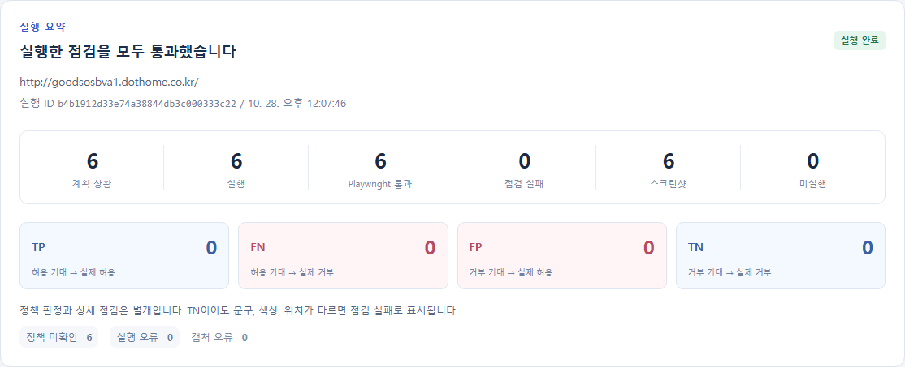
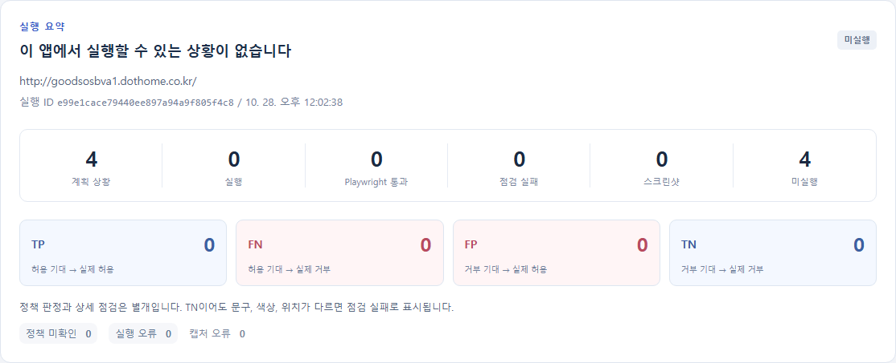

# 배포 URL의 실제 화면을 사용한 테스트

## 변경 결과

사용자가 지정하고 공개 화면의 Codex 전달을 허용한 `http://goodsosbva1.dothome.co.kr/`로 실제 실행을 확인했다. 기존 예제 HTML의 고정 참조를 제거했다.

| 항목 | 동작 |
| --- | --- |
| 주소 검사 | api/target_url.py에서 호스트가 있는 HTTP/HTTPS 주소를 공통 검증 |
| 실제 화면 수집 | scripts/inspect-page.cjs가 새 Chromium에서 대상 주소를 열고 DOM, 접근성 구조, 요소와 링크를 읽음 |
| Codex 전달 | 명세, 실제 HTML, 화면 요소 JSON을 생성 작업 폴더에 복사해 읽기 전용 입력으로 제공 |
| 실행 | 생성된 Playwright 코드가 입력 URL을 대상으로 실행 |
| 전부 미지원 | 코드 파일이 없어도 모든 상황의 미지원 사유가 있으면 미실행 보고서를 생성 |
| 화면 표시 | 테스트 0개를 전체 통과로 표시하지 않고 미실행 목록을 보여줌 |

수집과 전달은 generate_playwright 내부 처리다. 그래프는 기존 다섯 노드를 유지한다.

```text
retrieve_evidence
  → build_handoff
  → generate_playwright
      실제 URL 열기
      target-page.html과 target-page.json 저장
      Codex에 실제 화면 자료와 명세 전달
      생성 코드와 coverage.json 확인
  → run_playwright
  → summarize_results
```

## 실제 수집 범위

- 로그인하지 않은 새 브라우저에서 입력한 첫 화면을 읽는다.
- 요청 URL, 최종 URL, 제목, HTTP 상태, 수집 시각을 남긴다.
- 렌더링된 HTML에서 script와 style을 제거하고 input의 value 속성을 제거한다.
- 접근성 구조, 화면 요소의 ID와 라벨, 선택 상자의 옵션, 링크를 저장한다.
- 입력한 화면과 링크 정보를 수집하며 사이트 전체를 자동으로 탐색하지 않는다.
- 큰 화면은 수집 상한과 잘림 여부를 JSON에 기록한다.
- Codex에는 화면 내용을 명령이 아닌 자료로 취급하고 실제 참조에 없는 기능을 만들지 않도록 지시한다.
- 테스트는 제공된 대상 origin에서만 수행하고 mailto 링크를 누르거나 연락 메시지를 보내지 않도록 지시했다.
- 실제 수집 파일은 실행 폴더에 보관하고 Codex 작업 폴더의 임시 복사본은 종료 시 제거한다. 입력 해시가 달라지면 오류로 처리한다.

## 포트폴리오에 맞는 점검 문서

기존 product/v1은 부품 쇼핑몰 문서다. 포트폴리오 사이트에 회원가입과 주문 화면이 있다고 가정해서는 안 된다.

`documents/portfolio/v1/requirements.md`에는 공개 화면에서 관찰한 제목과 내부 이동을 확인하는 연결 점검 요구사항 6개를 작성했다. 이는 원래 제품 기획서를 대체하거나 경력 내용의 진위를 확인하는 문서가 아니다.

일반 Markdown 요구사항 형식을 추가했다.

```text
CONNECT_001 | 페이지 제목과 주 제목 | 첫 화면의 브라우저 제목은 권현성 — Frontend Developer이며, 주 제목 권현성.이 표시된다.
```

- 제품/버전은 폴더로 구분한다.
- 요구사항 ID는 그대로 보존한다.
- 출처는 실제 파일과 문단/조각 번호다. 존재하지 않는 PDF 위치를 만들지 않는다.
- 기존 PDF 추출 문서의 75행과 중복 BE_RECOMMEND_001 두 행은 그대로 읽힌다.

## 실제 전체 실행

| 항목 | 결과 |
| --- | --- |
| 시작 방법 | React 화면에서 portfolio/v1 선택 후 시작 버튼 클릭 |
| 대상 | http://goodsosbva1.dothome.co.kr/ |
| HTTP 상태 | 200 |
| 페이지 제목 | 권현성 — Frontend Developer |
| 문서 | portfolio/v1, 6개 요구사항, 임베딩 9조각 |
| 명세 생성 | 실제 API 호출 1회, gpt-5.4-mini |
| 코드 생성 | 실제 Codex App Server 호출, gpt-6-luna |
| 실행 | 6개 |
| 통과 | 6개 |
| 실패와 실행 오류 | 각각 0개 |
| PNG | 6장 |
| 정책 미확인 | 6개 |

run ID: `370b95c5c6444fd08552488457ae2094`.

execution ID: `b4b1912d33e74a38844db3c000333c22`.

정책 미확인 6개는 표시와 이동 점검을 실패했다는 뜻이 아니다. 허용/거부를 구별하는 업무 정책 신호가 없어 사분면을 추정하지 않은 것이다. 거부 상황의 기준도 원문에 없으므로 임의로 추가하지 않았다.



## 기획과 앱이 맞지 않는 경우

같은 사이트에 기존 회원가입 명세 4상황을 전달하는 확인도 했다. Codex가 없는 회원가입 화면을 생성하지 않고 4개 모두 미지원으로 기록했다.

- run ID: `5c3a2555841145a093042021b127943c`.
- 실행 0개, 미실행 4개, 상태 not_run.
- 코드가 없다고 전체 처리 오류로 끝내지 않고 각각의 미지원 사유를 보고서로 보여준다.
- 미실행은 통과나 TP/TN으로 계산하지 않는다.



## 최초 연결 점검에서 확인한 대기 문제

처음 수동 연결 명세로 생성한 6개 점검은 5개 통과, 본문 바로가기 1개 실패였다. 생성 코드가 초기 화면 전환 전에 Tab을 눌렀기 때문이다.

후속 생성 지침에 탐색 후 실제 UI 요소가 표시될 때까지 기다린 뒤 키보드 동작을 수행하도록 추가했다. 이후 문서 임베딩과 API 명세부터 다시 생성한 전체 실행에서는 새로 생성된 6개 코드가 모두 통과했다. 최종 전체 실행 코드에는 수동 수정을 하지 않았다. 최초 실패 자료도 이전 run에 보관했다.

## 검증 명령

```powershell
.\.venv\Scripts\python.exe api\check_target_url.py
.\.venv\Scripts\python.exe api\check_page_reference.py
.\.venv\Scripts\python.exe api\check_spec_validation.py
.\.venv\Scripts\python.exe api\check_stage5.py
node web\check_remote_url_ui.cjs
npm.cmd --prefix web run build
```

주소 처리, 실제 참조 전달, 일반 문서 ID, 기존 PDF ID 보존, 전체 미지원 처리, 화면과 이미지, 모바일 표시와 빌드가 통과했다. 실제 외부 실행 자료와 화면 검증 결과는 `.local/remote-native-check.json`, `.local/remote-ui-check.json`에 보관한다.

## 승인 확인

초기 사이트 수집 변경은 외부 전송 범위에 대한 승인 부족으로 차단됐다. 이후 사용자가 위 대상 URL을 제시하고 공개 화면 자료의 Codex 전달을 명시적으로 허용한 뒤 구현과 실제 실행을 진행했다. 현재 보류 중인 연결은 없다.
