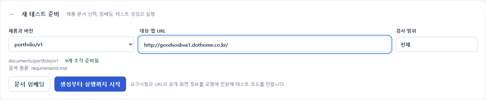

# Common Tester 사용설명서

이 설명서는 **현재 PC의 `D:\common_tester`에 설치된 Common Tester 2.0.1**을 기준으로 합니다. 처음에는 아래 준비된 포트폴리오 점검을 그대로 따라 하십시오.

> **바로 따라 할 설정**
> - 제품과 버전: `portfolio/v1`
> - 대상 앱 URL: `http://goodsosbva1.dothome.co.kr/`
> - 검사 범위: `전체`

## 1 무엇을 하는 프로그램인가

기획 문서와 실제 웹 화면을 비교하는 테스트를 만들어 실행합니다.

1. 기획 문서를 검색할 수 있도록 준비합니다. 이 작업이 **문서 임베딩**입니다.
2. 문서의 근거로 테스트 명세를 작성합니다.
3. 입력한 URL의 공개 화면을 브라우저로 읽습니다.
4. Codex가 실제 화면의 요소를 참고해 Playwright 코드를 만듭니다.
5. 코드를 실행하고 통과와 실패의 스크린샷을 저장합니다.
6. 결과 화면에서 기대 결과, 실제 결과, 원문, 오류와 이미지를 확인합니다.

**기획 문서와 대상 앱은 같은 제품에 관한 것이어야 합니다.** 쇼핑몰 기획서를 포트폴리오 사이트에 적용해 회원가입이나 주문 테스트를 만들어서는 안 됩니다. 실행할 화면이 없으면 이유와 함께 미실행으로 남깁니다.

## 2 먼저 확인할 준비물

현재 PC에는 실행 환경이 설치돼 있습니다. 매번 다시 설치할 필요는 없습니다.

| 준비물 | 확인할 내용 |
| --- | --- |
| 프로젝트 폴더 | `D:\common_tester`가 있어야 합니다. |
| OpenAI API 키 | `D:\common_tester\.env`에 설정돼 있어야 합니다. |
| Codex 로그인 | 코드 생성에 사용할 Codex가 로그인돼 있어야 합니다. |
| 인터넷 연결 | 모델 호출과 배포 사이트 접속에 필요합니다. |
| 브라우저 | Edge 또는 Chrome에서 Common Tester 화면을 엽니다. |

### API 키가 이미 설정됐다면

기존 `.env`를 그대로 사용합니다. 키가 없을 때만 메모장으로 파일을 만들고 아래 형식으로 저장합니다.

```text
OPENAI_API_KEY=여기에_본인_API키
```

- 설명 문구 대신 실제 키를 넣습니다.
- 파일 이름은 `.env`입니다. `.env.txt`로 저장하지 않습니다.
- 키를 바꿨다면 실행 중인 API 서버를 껐다가 다시 켭니다.
- 실제 키를 설명서나 화면 캡처에 적지 않습니다.

### Codex 로그인을 확인하려면

Windows 검색에서 **Windows PowerShell**을 열고 실행합니다.

```powershell
codex.cmd login status
```

로그인하지 않았다는 안내가 나오면 다음을 실행하고 브라우저에서 로그인합니다.

```powershell
codex.cmd login
```

다시 `codex.cmd login status`로 확인합니다. API 키와 Codex 로그인은 별개입니다. 명세 작성은 API를 사용하고 코드 생성은 로그인된 Codex를 사용합니다.

공식 로그인 안내: [OpenAI 인증 문서](https://learn.chatgpt.com/docs/auth).

## 3 Common Tester 켜기

먼저 브라우저에서 다음 주소를 엽니다.

**[Common Tester 열기](http://127.0.0.1:5173/)**

화면과 작업 기록이 정상적으로 보이면 이미 켜진 서버를 사용하면 됩니다. **4번으로 이동하십시오.**

화면이 열리지 않을 때만 아래 두 서버를 실행합니다.

### 첫 번째 PowerShell 창에서 API 켜기

아래 내용을 그대로 붙여 넣습니다. 줄 끝의 역따옴표도 포함해 복사합니다.

```powershell
Set-Location D:\common_tester
.\.venv\Scripts\python.exe -m uvicorn main:app `
  --app-dir api --host 127.0.0.1 --port 8000
```

`Uvicorn running on http://127.0.0.1:8000`이 보이면 정상입니다. **창을 닫지 않습니다.**

### 두 번째 PowerShell 창에서 화면 켜기

첫 번째 창을 둔 채 새 PowerShell 창을 엽니다.

```powershell
Set-Location D:\common_tester\web
npm.cmd run dev -- --port 5173 --strictPort
```

`http://127.0.0.1:5173/`이 보이면 정상입니다. 이 창도 닫지 않습니다.

- `npm.cmd`를 쓰면 PowerShell의 `npm.ps1` 실행 정책 오류를 피할 수 있습니다.
- 주소가 이미 사용 중이라는 오류가 나오면 같은 서버를 두 번 켰을 수 있습니다. 해당 주소가 정상으로 열리는지 먼저 확인합니다.
- 배포 사이트를 점검할 때는 로컬 예제 앱 서버를 켤 필요가 없습니다.

## 4 준비된 배포 사이트 테스트 시작

### 4-1 새 테스트 준비 열기

화면 위쪽의 **새 테스트 준비**를 누릅니다.

### 4-2 아래 세 값을 입력하기

| 입력 칸 | 넣을 값 |
| --- | --- |
| 제품과 버전 | `portfolio/v1` |
| 대상 앱 URL | `http://goodsosbva1.dothome.co.kr/` |
| 검사 범위 | `전체` |



이 사이트는 **HTTP 주소 그대로** 사용하십시오. 접속 확인은 위 주소로 했습니다.

`portfolio/v1`에는 다음 연결 확인용 요구사항이 준비돼 있습니다.

1. 페이지 제목과 주 제목 표시
2. 작업 메뉴 이동
3. 경력 메뉴 이동
4. 기술 메뉴 이동
5. 연락 메뉴 이동
6. 본문 바로가기 키보드 접근

이 문서는 사이트에서 관찰한 기본 표시와 이동을 확인하기 위한 것입니다. 경력 내용의 진위나 별도의 제품 업무 정책을 검증하는 문서는 아닙니다. 메일을 보내는 동작은 하지 않습니다.

### 4-3 문서 임베딩 확인

- **조각 준비됨**이 보이면 다음 단계로 갑니다.
- **임베딩 필요**가 보이거나 문서를 바꿨다면 **문서 임베딩**을 누릅니다.
- 완료 안내가 나온 뒤 시작합니다.
- 문서가 바뀌지 않았다면 매번 임베딩할 필요는 없습니다.

### 4-4 생성부터 실행까지 시작

**생성부터 실행까지 시작**을 한 번 누릅니다.

화면의 진행 순서는 아래와 같습니다.

| 화면 표시 | 진행 중인 일 |
| --- | --- |
| 근거 검색 | 선택한 제품과 버전의 문서 근거를 가져옵니다. |
| 명세 작성 | API 모델이 근거를 테스트 상황으로 정리합니다. |
| 코드 생성 | 실제 대상 화면을 수집하고 Codex가 테스트를 작성합니다. |
| 브라우저 실행 | Playwright가 대상 사이트에서 점검합니다. |
| 결과 집계 | 실패, 미실행, 원문과 스크린샷을 연결합니다. |

- 몇 분 걸릴 수 있습니다. 화면은 3초마다 진행을 조회합니다.
- 진행 중에는 시작 버튼을 반복해서 누르거나 API 서버 창을 닫지 않습니다.
- `headless_shell.exe`가 잠깐 보일 수 있습니다. Playwright가 실행한 화면 없는 Chromium 브라우저이며 작업 후 종료합니다.
- **작업 중단**이 보이면 현재 노드와 아래 오류 문구를 확인합니다.

## 5 결과 확인

완료되면 **실행 기록**, **실행 요약**, **점검 목록**이 나타납니다.


| 표시 | 읽는 방법 |
| --- | --- |
| 계획 상황 | 기획 문서에서 생성한 전체 상황 수입니다. |
| 실행 | 실제로 실행한 테스트 수입니다. |
| Playwright 통과 | 테스트 코드의 점검을 통과한 수입니다. |
| 점검 실패 | 기대 결과를 만족하지 못한 점검 수입니다. |
| 미실행 | 화면이나 사전 조건 부족으로 실행하지 못한 상황 수입니다. |
| 정책 미확인 | 허용과 거부 중 무엇인지 확실하게 관찰할 수 없는 항목입니다. |
| 실행 오류 | 접속, 선택자, 시간 초과 등으로 점검을 끝내지 못한 경우입니다. |

### 준비된 포트폴리오 점검의 실제 확인 결과

2026년 10월 28일 화면에서 시작한 전체 흐름으로 **6개 실행, 6개 통과, 스크린샷 6장, 실행 오류 0개**를 확인했습니다.

**정책 미확인 6개는 실패 6개라는 뜻이 아닙니다.** 제목과 화면 이동은 점검을 통과했지만 허용과 거부를 구별하는 업무 정책 신호가 없으므로 TP나 TN으로 추측하지 않았습니다.

새로 명세와 코드를 만들면 상황 수가 달라질 수 있습니다. 항상 6개가 나온다는 보장은 없습니다.

### TP와 FN과 FP와 TN

| 분류 | 의미 |
| --- | --- |
| TP | 허용해야 하는 상황을 실제로 허용했습니다. |
| FN | 허용해야 하는 상황을 잘못 거부했습니다. |
| FP | 거부해야 하는 상황을 잘못 허용했습니다. |
| TN | 거부해야 하는 상황을 실제로 거부했습니다. |

정책 판정과 상세 점검은 별개입니다. 예를 들어 거부 자체는 정상이어도 경고 색상이 틀리면 **TN과 상세 점검 실패**가 함께 표시됩니다.

## 6 실패와 스크린샷 확인

1. **점검 목록**에서 **실패**를 누릅니다.
2. 실패 항목을 펼칩니다.
3. **기대 결과**, **실제 화면 신호**, 빨간 오류 내용을 읽습니다.
4. **기획 원문과 출처**를 펼쳐 어떤 문장을 근거로 만든 점검인지 확인합니다.
5. **스크린샷 크게 보기**를 누릅니다.
6. **닫기** 또는 **Escape 키**로 돌아옵니다.
7. 통과한 항목도 펼치면 스크린샷을 볼 수 있습니다.

실패가 모두 대상 앱의 버그라는 뜻은 아닙니다. 다음을 구분합니다.

| 상황 | 확인할 대상 |
| --- | --- |
| 기획에 있는 기능이나 표시가 없음 | 대상 앱이 기획을 만족하는지 확인합니다. |
| 없는 선택자를 찾거나 비활성 버튼을 클릭함 | 생성된 테스트 코드를 확인합니다. |
| 접속이 안 되거나 브라우저가 시작되지 않음 | 주소와 실행 환경을 확인합니다. |

**미실행**을 누르면 실행하지 못한 이유가 항목마다 나옵니다. 화면이 없는 항목을 통과로 계산하지 않습니다. 점검 검색에는 요구사항 ID나 제목을 입력할 수 있습니다.

모든 상황이 대상 앱과 맞지 않으면 **이 앱에서 실행할 수 있는 상황이 없습니다**로 표시하고 미실행 목록을 보여줍니다. 테스트 0개를 전체 통과라고 표시하지 않습니다.

## 7 수정한 뒤 다시 실행

| 원하는 작업 | 누를 버튼 |
| --- | --- |
| 대상 앱만 수정한 뒤 같은 점검을 다시 실행 | **같은 코드 다시 실행** |
| 같은 문서로 명세와 코드를 새로 생성 | **생성부터 실행까지 시작** |
| 기획 문서를 바꾼 뒤 다시 검사 | **문서 임베딩** 후 **생성부터 실행까지 시작** |

- **같은 코드 다시 실행**은 모델을 다시 호출하지 않고 기존 코드를 실행합니다.
- **생성부터 실행까지 시작**은 API 모델과 Codex를 다시 사용합니다.
- 이전 결과는 왼쪽 **작업 기록**과 **실행 기록**에서 다시 선택합니다.
- 주소창 전체 주소를 저장하면 해당 실행 결과를 다시 열 수 있습니다.

## 8 다른 제품의 기획 문서 준비

현재 화면에는 문서 업로드 버튼이 없습니다. 파일 탐색기와 메모장으로 준비합니다.

### 8-1 제품과 버전 폴더 만들기

예를 들어 다음 폴더를 만듭니다.

```text
D:\common_tester\documents\myapp\v1
```

제품과 버전 폴더 이름에는 영문, 숫자, 점, 밑줄, 하이픈을 사용합니다.

### 8-2 requirements.md 만들기

위 폴더에서 메모장으로 `requirements.md`를 만들고 UTF-8로 저장합니다. 파일 이름이 `requirements.md.txt`가 되지 않게 확인합니다.

요구사항은 **ID | 이름 | 내용** 형식으로 적습니다. 항목 사이에는 빈 줄을 넣습니다.

```text
# 내 앱 요구사항

REQ_001 | 페이지 제목 | 첫 화면에는 내 서비스라는 주 제목이 표시된다.

REQ_002 | 도움말 이동 | 도움말 링크를 누르면 도움말 화면으로 이동한다.
```

- 위 문구는 형식 예시입니다. **본인 앱의 실제 기획 문장으로 바꿉니다.**
- ID는 요구사항을 구별하는 이름표입니다. `REQ_001`처럼 대문자, 숫자, 밑줄을 사용합니다.
- 제품과 버전은 폴더로 구별합니다. PDF 쪽수를 임의로 붙일 필요가 없습니다.
- 원래 요구사항 ID가 있다면 유지합니다.
- 성공이나 거부의 기준이 원문에 없다면 임의로 만들지 않습니다.

### 8-3 화면에서 새 제품 선택

1. Common Tester의 **기록 새로고침**을 누릅니다.
2. **새 테스트 준비**에서 `myapp/v1`을 선택합니다.
3. **문서 임베딩**을 누릅니다.
4. 대상 앱 URL과 검사 범위를 넣습니다.
5. **생성부터 실행까지 시작**을 누릅니다.

임의의 PDF를 폴더에 넣는 것만으로 자동 변환되지는 않습니다. 기본 `product/v1`의 PDF는 미리 정리한 `requirements.md`를 사용합니다. 처음에는 위 Markdown 형식을 이용하십시오.

## 9 로컬 예제 앱으로 확인하고 싶다면

새 PowerShell 창에서 실행합니다.

```powershell
Set-Location D:\common_tester
.\.venv\Scripts\python.exe -m http.server 8765 `
  --bind 127.0.0.1 --directory examples
```

새 테스트 준비에 다음을 입력합니다.

| 항목 | 값 |
| --- | --- |
| 제품과 버전 | `product/v1` |
| 대상 앱 URL | `http://127.0.0.1:8765/product-demo.html` |
| 검사 범위 | `전체` |

이 예제는 부품 쇼핑몰 요구사항의 일부 화면만 구현합니다. 미지원 항목이 많이 나올 수 있습니다.

## 10 문제가 생겼을 때

| 증상 | 확인과 해결 |
| --- | --- |
| 5173 화면이 열리지 않음 | 3번의 API와 화면 서버를 켭니다. |
| Failed to fetch 또는 API 오류 | 8000 API 서버를 켠 뒤 기록 새로고침을 누릅니다. |
| 임베딩이 없거나 원문이 변경됐다는 오류 | 문서 임베딩을 다시 하고 시작합니다. |
| API 키 오류 또는 401 | .env의 키를 확인하고 API 서버를 다시 켭니다. |
| Codex CLI를 찾지 못함 | codex.cmd login status가 실행되는지 확인합니다. 실행 파일 경로 설정이 필요할 수 있습니다. |
| 주소가 이미 사용 중 | 기존 서버가 켜져 있는지 해당 주소를 열어 봅니다. 정상으로 열리면 기존 서버를 사용합니다. |
| 대상 화면을 읽지 못했다는 오류 | 대상 URL을 일반 브라우저로 열어 주소, 응답, 접근 가능 여부를 확인합니다. |
| 작업 중단 | 현재 노드와 오류를 기록합니다. 서버 재시작으로 중단된 작업은 새 작업으로 시작합니다. |
| 전체 미실행 | 기획서와 대상 앱이 일치하는지, 필요한 화면이 있는지 확인합니다. |
| 스크린샷 없는 실행 오류 | 페이지가 만들어지기 전에 실패했다면 캡처할 수 없습니다. |

## 11 자료 보관과 종료

화면의 **실행 파일과 코드**를 펼치면 실행 결과와 코드 사본을 받을 수 있습니다.

```text
D:\common_tester\.local\runs\작업ID\
  evidence.json             검색한 근거
  test-spec.json            테스트 명세
  target-page.html          실제 대상 화면의 HTML
  target-page.json          URL과 화면 요소 정보
  generated-tests\          생성한 코드와 지원 여부
  executions\실행ID\         결과와 스크린샷과 코드 사본
```

공개 화면은 새 브라우저에서 읽습니다. 로그인 세션을 가져오는 기능은 추가하지 않았습니다. 현재 수집 범위는 입력한 첫 화면과 그 화면의 링크 및 요소 정보이며 전체 사이트 자동 탐색은 아닙니다.

종료할 때는 실행 중인 테스트가 끝난 뒤 직접 켠 각 PowerShell 창에서 **Ctrl+C**를 누릅니다. 명령 입력 줄이 돌아오면 창을 닫습니다. 브라우저를 닫아도 저장된 결과는 지워지지 않습니다.
